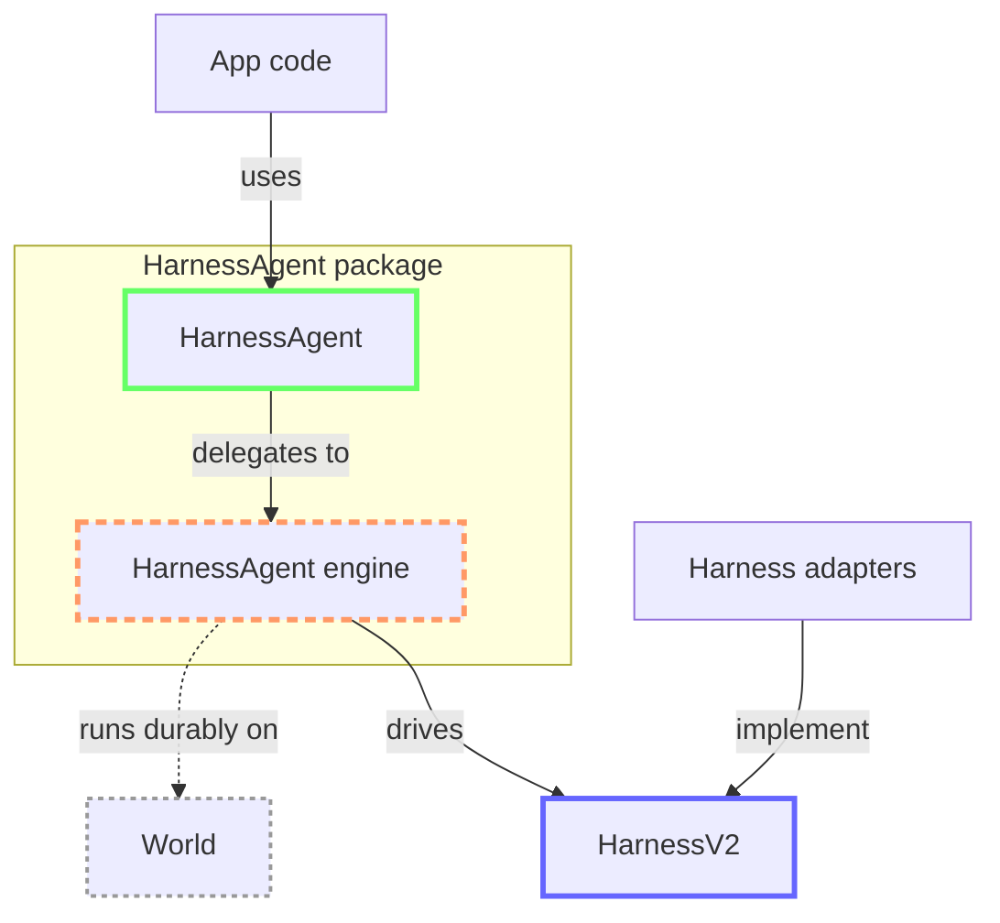

# Merging `durable-harness` into `HarnessAgent`

**What:** Merge the features that `vercel-labs/durable-harness` offers into the `HarnessAgent` layer of AI SDK.
**How:** Design a V2 of the experimental harness adapter spec focused on built-in durability and multitenancy, while making both opt-in.

## Challenges

`HarnessAgent` and `durable-harness` have different feature sets. The abstraction needs to be able to cater for the merged feature set from both:

| Feature                     | `HarnessAgent` | `durable-harness` |
| --------------------------- | -------------- | ----------------- |
| Durable sessions            | ❌             | ✅                |
| At-most-once tool execution | ❌             | ✅                |
| Multitenant support         | ❌             | ✅                |
| Tool approvals              | ✅             | ❌                |
| Agent step boundaries       | ✅             | ❌                |
| Active tool filtering       | ✅             | ❌                |
| Client-side tools           | ✅             | ❌                |
| Structured output           | ✅             | ❌                |
| Lifecycle callbacks         | ✅             | ❌                |
| Per-turn settings           | ✅             | ❌                |

The objective is to bring the three major features from `durable-harness` to `HarnessAgent`.

## Proposed high-level architecture

- `HarnessAgent`'s constructor settings receive a new `world?: World` setting (see `@workflow/world`), which opts in to durable execution.
- `HarnessV2` is a complete redesign of the harness adapter abstraction layer, iteratively replacing `HarnessV1`.
- `HarnessV2` exclusively covers layers that are relevant to the individual harness adapter implementations. Anything that is framework-internal must be kept out of it and belongs into `HarnessAgent`'s underlying internals.

The internals in between are referred to as the **`HarnessAgent` engine**: part of `HarnessAgent`, but not exported and not public API in any way.



Green and blue boxes are public API; the dashed orange box is internal.

- **`HarnessAgent`:** the public consumer API that app code uses: `stream()`, `generate()`, sessions, stream parts, `UIMessage` streams and lifecycle callbacks. This API will not notably change, other than receiving the new `world?: World` setting.
- **`HarnessV2`:** the public API for harness adapter makers: `drive()` with its drive context (`log`, `effect()`, `executeHostTool()`, `executeBuiltinTool()`, `gateBuiltinTool()`, `finishStep()`, `finishTurn()`, and the exceptional `unsafeEmit()`). See section below for details. Stream parts are emitted through the effect context's `emit()`, the only adapter-facing function with that name.
  - `HarnessV2EffectFunction` declares the generic call signature used by the `HarnessV2DriveContext.effect` property.
- **`HarnessAgent` engine:** the internal layer, not exported. Among other things, it:
  - translates `HarnessV2` stream parts into consumer stream types
  - receives submissions in the session's inbox, tracks which ones were delivered, and applies withdrawals
  - orchestrates host tool execution: start and end effect capture, active tool filtering, tool approvals, client-side tool results
  - gates built-in tools: start and end effect capture, tool approvals
  - records finished AI SDK steps as framework-internal log events, evaluates `stopWhen`, and holds the next step's start until the check is done
  - resolves effects a dead process left behind during recovery (`interrupted`, with `retryable` from `replay`)
  - records yielded effect values as internal `effect-progress` events with `{ startId, partial }`; these events belong only to `HarnessAgentLogEvent`, never to `HarnessV2LogEvent`
- **Harness adapters:** implementations of `HarnessV2`, such as Pi, Claude Code and Codex.
- **World:** optional. Providing one opts in to durable mode; the engine then uses it for storage, queueing and streams. Adapters never access it directly.

### `HarnessV2` spec

This is the proposed spec for `HarnessV2`, the harness adapter abstraction.

```ts
export type HarnessV2 = {
  /**
   * Spec version this adapter implements. Always the literal `'harness-v2'`,
   * so the agent can refuse adapters written against another version.
   */
  specificationVersion: 'harness-v2';
  /**
   * Stable identifier of the harness, e.g. `'claude-code'`. Recorded with the
   * session, so a session is never driven by a different harness.
   */
  harnessId: string;
  /**
   * Tools the underlying runtime brings itself (e.g. `Bash`, `Edit`). The agent
   * merges them with the app's tools for validation, typing and approvals.
   */
  builtinTools: ToolSet;
  /**
   * Optional recipe of files and commands that prepare a sandbox for this
   * harness. The agent applies it idempotently and can snapshot the result.
   */
  getBootstrap?(options: {
    abortSignal?: AbortSignal;
  }): PromiseLike<HarnessV2Bootstrap>;
  /**
   * Drives the session forward from its log until it is idle, yields or is
   * stopped. Holds no state between calls: everything needed is in `context`.
   *
   * Resolves with nothing: the agent already knows why a drive ended, from
   * the `finishStep()` and `finishTurn()` calls, the `suspended` outputs it
   * returned, the signals it aborted, or the error thrown. A drive that
   * returns with an unfinished turn and no such reason is driven again.
   */
  drive(options: {
    sessionId: string;
    context: HarnessV2DriveContext;
  }): PromiseLike<void>;
};

/**
 * A submission as the harness sees it. Only `prompt` and `steer` reach the
 * harness; everything else is handled by the agent.
 */
type HarnessV2Submission =
  | {
      /**
       * Starts a turn, after the running one ends if there is one, with the
       * turn settings the agent evaluated for it.
       */
      readonly type: 'prompt';
      readonly message: UserModelMessage;
      readonly settings: HarnessV2TurnSettings;
    }
  | {
      /**
       * Joins the running turn, at the runtime's next opportunity. Carries no
       * turn settings.
       */
      readonly type: 'steer';
      readonly message: UserModelMessage;
    };

// Ideally `T extends HarnessV2SerializableValue`; omitted because interfaces
// (e.g. inside `ToolResultOutput`) never satisfy an index signature type.
type HarnessV2EffectOutput<T = HarnessV2SerializableValue> =
  | {
      readonly type: 'result';
      /**
       * On replay, `effect()` returns this decoded value, not what `fn`
       * would return now, so it can have the shape an older version of the
       * adapter wrote.
       */
      readonly value: T;
    }
  | { readonly type: 'error'; readonly error: string }
  | {
      /**
       * The attempt was cut off before it finished. `retryable: true` means
       * it produced no final output and the next `effect()` call for this key runs
       * `fn` again; `false` means the attempt is final and may have acted.
       */
      readonly type: 'interrupted';
      readonly retryable: boolean;
      /**
       * The last value `fn` yielded that the log recorded before the attempt
       * was cut off. Every yield is a complete value of the output type, not
       * a fragment, so this has the same type as `value`. Not set when `fn`
       * is not a generator or yielded nothing.
       */
      readonly partial?: T;
    };

type HarnessV2Effect = {
  readonly key: string;
  readonly attempt: number;
  readonly name: string;
  readonly replay: 'safe' | 'never';
  /**
   * What the effect works on, recorded in its start event. Lets readers of the
   * log (and a replay divergence check) see what each attempt was given.
   */
  readonly input: HarnessV2SerializableValue;
  /**
   * Ids of the submissions whose user messages this effect hands to the model
   * or runtime for the first time. After that, a submission can no longer be
   * withdrawn, and a delivered `prompt` starts a turn.
   *
   * Only one turn runs at a time, and each turn starts with one prompt: a
   * prompt submitted while a turn is running waits until that turn finished.
   * So an effect may deliver at most one prompt that has not started a turn
   * yet, and only once the previous turn finished. Otherwise `effect()`
   * rejects with `HarnessInvalidDriveStateError` without recording anything.
   */
  readonly deliveredSubmissionIds: readonly string[];
  readonly output?: HarnessV2EffectOutput;
};

/**
 * One event in the session's append-only log. Framework log events (types
 * without a prefix) are written by the agent and have spec-defined shapes;
 * harness log events (`harness:` types) are written by the adapter.
 *
 * This type only lists the log events relevant to the adapter. The agent may
 * write further framework-internal log events (e.g. finished AI SDK steps for
 * `stopWhen`), typed by its own superset of this type; `read()` never returns
 * them to the adapter.
 *
 * Every `data` is a `HarnessV2SerializableValue`. The internal layer encodes
 * it; without a World it should still round-trip it, so a value that cannot
 * be serialized fails the same way in both execution modes.
 */
type HarnessV2LogEvent =
  | {
      /**
       * A submission the agent received, e.g. from `stream()`. Withdrawn
       * submissions are never returned; approval responses and client tool
       * results are consumed by `executeHostTool()` and `gateBuiltinTool()` instead.
       */
      readonly type: 'submission';
      readonly data: HarnessV2Submission;
      readonly id: string;
    }
  | {
      /**
       * The start event of one effect attempt, written right before it runs.
       * Every start event gets exactly one end event, unless the current drive
       * is still running that effect.
       */
      readonly type: 'effect-start';
      readonly data: Omit<HarnessV2Effect, 'output'>;
      readonly id: string;
    }
  | {
      /**
       * The end event of one effect attempt. `startId` is the `id` of its
       * start event. For an attempt a dead process left behind, the agent
       * writes it during recovery as `interrupted`.
       */
      readonly type: 'effect-end';
      readonly data: {
        readonly startId: string;
        readonly output: NonNullable<HarnessV2Effect['output']>;
      };
      readonly id: string;
    }
  | {
      /**
       * A finished turn, written by the agent: when the harness calls
       * `finishTurn()`, or when the agent ends the turn itself (e.g. a failed
       * drive, later a cancellation). The harness reads it when rebuilding,
       * so it never resumes a turn the agent already ended.
       */
      readonly type: 'finish-turn';
      readonly data: {
        /**
         * ID of the turn. Opaque to the harness.
         */
        readonly turnId: string;
        readonly finishReason: LanguageModelV4FinishReason;
        readonly totalUsage: LanguageModelV4Usage;
        readonly harnessMetadata?: HarnessV2Metadata;
      };
      readonly id: string;
    }
  | {
      /**
       * Harness-chosen type grouping the adapter's own events into their own
       * ordered sequence (e.g. `harness:rollout:<threadId>`).
       */
      readonly type: `harness:${string}`;
      /**
       * The event's payload. Large values are offloaded to blob storage and
       * resolved again by the internal layer; the harness always sees all of it.
       */
      readonly data: HarnessV2SerializableValue;
      /**
       * Optional harness-defined identity, e.g. a runtime's native event id.
       * Must be the same in every process: an event whose id is already in
       * the log is not written again.
       */
      readonly id?: string;
    };

/**
 * What `executeHostTool()` resolves with: what to send back to the model for the
 * call, or that the call cannot be answered yet. The call's id, name and
 * input are not repeated, since the adapter passed them in.
 *
 * The agent records each execution as an effect, so `result`, `error` and
 * `interrupted` derive from that effect's output. For a tool call, `error`
 * also covers invalid calls (e.g. an unknown tool or invalid input), and
 * `partial` is the last preliminary result of a tool whose `execute` is an
 * async generator. An `interrupted` call that is not retryable may have
 * acted, so the model should be told its output is unknown.
 *
 * Tool values are always JSON, converted the way the AI SDK converts tool
 * outputs for the model, and wrapped as `{ raw, modelOutput? }` in both the
 * `result` value and the `interrupted` partial. `modelOutput` is present only
 * on a final value and only when the tool transforms its output for the model
 * (`toModelOutput`); otherwise the adapter sends `raw`.
 */
type HarnessV2ToolResultOutput = ToolResultOutput;

type HarnessV2ToolExecutionValue<T extends JSONValue = JSONValue> = {
  readonly raw: T;
  readonly modelOutput?: HarnessV2ToolResultOutput;
};

type HarnessV2ToolExecutionOutput<T extends JSONValue = JSONValue> =
  | HarnessV2EffectOutput<HarnessV2ToolExecutionValue<T>>
  | {
      /**
       * Something denied the call, so the tool never ran: an approval
       * response, or (for built-in tools) the runtime's own permission check.
       * `reason` is text for the model, e.g. "This tool call was denied:
       * <the approval response's reason, if any>".
       */
      readonly type: 'denied';
      readonly reason: string;
    }
  | {
      /**
       * The call cannot be answered while this drive runs: it waits for an
       * approval response or for a client tool result. The adapter ends its
       * turn work; a later drive calls `executeHostTool()` again for the same call.
       */
      readonly type: 'suspended';
      readonly reason: 'approval' | 'client-tool';
    };

/**
 * What `gateBuiltinTool()` resolves with: whether the runtime may run the
 * built-in tool call now. The adapter translates it into the runtime's own
 * permission decision, e.g. a `PreToolUse` hook's allow or deny.
 */
type HarnessV2ToolGateOutput =
  | {
      /**
       * The runtime may run the call. Its start event is already in the log,
       * so a crash while the runtime runs it is recorded as `interrupted`.
       */
      readonly type: 'approved';
      /**
       * Reports a partial value of the running call (e.g. streamed command
       * output). Each value is complete and replaces the previous one, not a
       * delta. Recorded as the call's latest partial output (`effect-progress`)
       * and emitted as a preliminary `tool-result` part. Resolves once
       * committed; does nothing once the call ended.
       */
      partial(value: HarnessV2ToolExecutionValue): Promise<void>;
      /**
       * Ends the call with the runtime's result, e.g. from its after-hook
       * (`PostToolUse`). Recorded as the call's `effect-end` and emitted as
       * the final `tool-result` part.
       *
       * Call exactly one of `result()` and `error()`: the first call wins and
       * later calls (including `partial()`) do nothing. When the drive ends,
       * the agent records every approved call that never ended as
       * `interrupted` and reports a development error, since the adapter
       * missed the runtime's report for it.
       */
      result(value: HarnessV2ToolExecutionValue): Promise<void>;
      /**
       * Ends the call with the runtime's failure, e.g. from its failure hook
       * (`PostToolUseFailure`), emitted as an error `tool-result` part. Same
       * rules as `result()`.
       */
      error(error: HarnessV2EffectError): Promise<void>;
    }
  | {
      /**
       * The runtime must not run the call, and the adapter passes `reason` to
       * it (e.g. as a `PreToolUse` deny reason). Text for the model written by
       * the agent: for a call that is already recorded (it ran or was
       * interrupted), a tool that is not a built-in tool, a drive that
       * stopped, and later an approval response that denied the call or a
       * tool that is filtered out.
       */
      readonly type: 'denied';
      readonly reason: string;
    }
  | {
      /**
       * The call waits for an approval response that won't arrive while this
       * drive runs. The adapter stops the runtime and ends its turn work.
       * Built-in tools have no client tool results, so approval is the only
       * reason.
       */
      readonly type: 'suspended';
      readonly reason: 'approval';
    };

/**
 * What `effect()` passes to `fn` for one attempt. Partial results are not
 * reported through it: `fn` yields them as an async generator instead.
 */
interface HarnessV2EffectContext {
  /**
   * Aborted when this attempt must stop, e.g. the drive is ending, ownership
   * of the session moved to another drive, or the turn was cancelled.
   */
  abortSignal: AbortSignal;
  /**
   * The `id` of this attempt's `effect-start` log event, the same value its
   * `effect-end` event carries as `startId`.
   */
  startId: string;
  /**
   * Emits a stream part produced by this attempt, already normalized, to the
   * agent's output (stream results, live stream, UI). This is the regular way
   * for a harness to emit content parts (text, reasoning, tool parts).
   *
   * Replay-safe: a replayed effect does not run its callback, so nothing is
   * emitted again. The agent attributes each part to this attempt; after a
   * crash it withdraws the output of interrupted attempts. Parts emitted
   * after the attempt ended are dropped.
   * Step and turn ends go through `finishStep()` and `finishTurn()` on the
   * drive context.
   */
  emit(part: HarnessV2StreamPart): void;
}

/**
 * Host-provided function that runs a keyed effect and records its output.
 * Takes a single options object, e.g.
 * `effect({ key, name, replay, input, fn: async context => ... })`.
 */
type HarnessV2EffectOptions<
  T extends HarnessV2SerializableValue = HarnessV2SerializableValue,
> = Pick<HarnessV2Effect, 'key' | 'name' | 'replay' | 'input'> &
  Partial<Pick<HarnessV2Effect, 'deliveredSubmissionIds'>> & {
    fn: (context: HarnessV2EffectContext) => PromiseLike<T> | AsyncIterable<T>;
  };

type HarnessV2EffectFunction = <
  T extends HarnessV2SerializableValue = HarnessV2SerializableValue,
>(
  options: HarnessV2EffectOptions<T>,
) => Promise<HarnessV2EffectOutput<T>>;

/**
 * Key-value storage for the session, for state the harness changes that
 * must survive drives (e.g. a setting the harness changes mid-turn). The
 * agent stores it in the log, so it is ordered with effects and part of
 * lifecycle state. Never for secrets: use `credentials`.
 */
interface HarnessV2Store {
  get<T extends HarnessV2SerializableValue>(
    key: string,
  ): Promise<T | undefined>;
  set(key: string, value: HarnessV2SerializableValue): Promise<void>;
  delete(key: string): Promise<void>;
}

interface HarnessV2DriveContext {
  /**
   * The session's append-only log: in memory without a World, backed by the
   * World run's event log with one.
   */
  log: {
    /**
     * Returns the session's log events in log order, optionally only those
     * after `after` and of the given `types`, plus the `position` where this
     * read ended. Used to rebuild state on every drive and to read what's new.
     *
     * `position` is always a position in the whole log, never a count within
     * one type: it means "every event of `types` up to here has been seen".
     * Pass it as `after` to the next read with the same `types` (or a subset);
     * reusing it with other types can skip events. The harness's own appended
     * events are returned too, in their actual place among external ones.
     *
     * Submissions are log events too. A `prompt` submission carries the turn
     * settings the agent evaluated for it (model, instructions, skills, tools,
     * response format, permission mode): the harness applies them when it
     * places the submission and starts the turn (after the running turn ends,
     * if there is one), and a resumed turn keeps them. A `steer` submission
     * joins the running turn and carries none.
     */
    read(options?: {
      after?: number;
      types?: HarnessV2LogEvent['type'][];
    }): Promise<{ events: HarnessV2LogEvent[]; position: number }>;
    /**
     * Appends one of the harness's own events, such as a journal record.
     * Resolves `true` once the event is accepted, or `false` if an event with
     * its `id` is already in the log (then nothing is written).
     *
     * Resolving does not mean durable: the internal layer batches writes and
     * waits for them before a `never` effect and before the drive ends. In
     * durable mode a write can be refused by the fence; the drive must stop.
     */
    append(
      event: Extract<HarnessV2LogEvent, { type: `harness:${string}` }>,
    ): Promise<boolean>;
    /**
     * Notifies the listener when log events arrive from outside this drive,
     * e.g. a `steer` submission mid-turn. The listener reads them with
     * `read({ after })`. Returns the unsubscribe function.
     */
    onAppend(listener: () => void): () => void;
  };
  /**
   * Key-value store for the session, under the hood relying on log events.
   */
  store: HarnessV2Store;
  /**
   * Runs `fn` as one Workflow step: returns the recorded output for `key` if
   * there is one, otherwise writes the start event, runs `fn`, writes the end
   * event. After a crash, recovery records the attempt as `interrupted`, with
   * `retryable` set from `replay` (`safe` is retryable, `never` is not). A
   * recorded retryable `interrupted` is not replayed: `fn` runs again when
   * the new drive's signal is active. An unfinished start alone is not proof
   * that its process stopped; it requires engine recovery before retrying.
   * Competing starts and ends are resolved in committed log order: the first
   * eligible start and first end win, and late events cannot change them.
   *
   * Never rejects with the outcome of `fn`: a thrown error becomes an `error`
   * output, and an abort of `stopAbortSignal` becomes an `interrupted` output, so
   * the first run and a replay return the same shape. The only exception is
   * `HarnessInvalidDriveStateError` thrown from `fn`, which records an
   * interruption before propagating to the agent. Serialization and storage
   * failures reject rather than becoming callback error outputs; a failed
   * interruption write also propagates its storage failure.
   *
   * Cancellation is cooperative: a pending callback or iterator operation
   * must settle before interruption can be recorded. The current invocation
   * returns its interruption without retrying under an aborted signal. An
   * already-aborted drive starts no attempt, while committed terminal outputs
   * remain replayable. Cancellation cannot overwrite a committed end.
   *
   * `fn` is either a regular async function, whose return value is the
   * output, or an async generator, whose yielded values are recorded as
   * partial results and whose last yielded value is the output (its return
   * value is ignored), the same contract as an AI SDK tool's `execute`.
   * Every yield is committed before requesting the next value. Interruption
   * includes the latest committed partial, including a yielded `undefined`.
   * An async function returning `undefined` or a generator yielding nothing
   * completes with `{ type: 'result', value: undefined }`.
   */
  effect: HarnessV2EffectFunction;
  /**
   * Executes one of the app's own tools. The agent handles filtering,
   * approvals, client tool results, and recording the execution as an effect
   * (`tool:${toolCallId}`, with the tool's `replay` policy). It also emits
   * the call's `tool-result` parts; the adapter must not emit them. `input`
   * must already be parsed from the model's JSON.
   */
  executeHostTool<T extends JSONValue = JSONValue>(call: {
    toolCallId: string;
    toolName: string;
    input: JSONValue;
  }): Promise<HarnessV2ToolExecutionOutput<T>>;
  /**
   * Executes one of the harness's built-in tools whose implementation the
   * adapter runs itself (e.g. Pi's tools operating on the sandbox). The agent
   * records the call as the effect `tool:${toolCallId}` (with the built-in
   * tool's `replay` policy) and runs `execute` inside it, so a recorded call
   * returns its recorded outcome without running again. It also emits the
   * call's `tool-result` parts; the adapter must not emit them. `input` must
   * already be parsed from the model's JSON.
   */
  executeBuiltinTool<T extends JSONValue = JSONValue>(call: {
    toolCallId: string;
    toolName: string;
    input: JSONValue;
    execute: (options: {
      abortSignal: AbortSignal;
    }) =>
      | PromiseLike<HarnessV2ToolExecutionValue<T>>
      | AsyncIterable<HarnessV2ToolExecutionValue<T>>;
  }): Promise<HarnessV2ToolExecutionOutput<T>>;
  /**
   * Called from the runtime's permission point before a built-in tool runs.
   * Resolves with `approved` (start event written; the adapter reports the
   * outcome through `result()` or `error()`), `denied` (a reason to report
   * instead of running it, e.g. for a call that is already recorded) or
   * `suspended` (waiting for an approval). The agent records the call as the
   * effect `tool:${toolCallId}` and emits its `tool-result` parts; the adapter
   * must not emit them. `input` must already be parsed from the model's JSON.
   */
  gateBuiltinTool(call: {
    toolCallId: string;
    toolName: string;
    input: JSONValue;
  }): Promise<HarnessV2ToolGateOutput>;
  /**
   * Lazily attaches the session's sandbox for this drive.
   */
  sandbox(): Promise<{
    session: SandboxSession | HarnessV2NetworkSandboxSession;
    workDir: string;
  }>;
  /**
   * Finishes the current AI SDK step: one model call plus the tool calls
   * resulting from it, however many effects that spans. Every step must be
   * finished this way (there is no `start-step`: the agent adds it for
   * consumers before a step's first part). `stepNumber` is counted by the
   * adapter, zero-based within the current turn (like AI SDK's
   * `StepResult.stepNumber`), and keeps counting across drives.
   *
   * The agent records the step in the log and emits `finish-step` only on the
   * first call for that `stepNumber` in the turn; a call replayed after a
   * crash records and emits nothing. It resolves once the step is recorded,
   * so the harness must await it before starting the next step.
   */
  finishStep(options: {
    stepNumber: number;
    finishReason: LanguageModelV4FinishReason;
    usage: LanguageModelV4Usage;
    harnessMetadata?: HarnessV2Metadata;
  }): Promise<void>;
  /**
   * Finishes the current turn (`finishReason: 'error'` for a turn the
   * runtime failed). Every turn must be finished this way. The agent derives
   * the turn's identity from the prompt submission that started it, records
   * the finish in the log and emits `finish` only on the first call; a call
   * replayed after a crash records and emits nothing.
   */
  finishTurn(options: {
    finishReason: LanguageModelV4FinishReason;
    totalUsage: LanguageModelV4Usage;
    harnessMetadata?: HarnessV2Metadata;
  }): Promise<void>;
  /**
   * Undesirable exception: only ever call this if the harness is unable to
   * run its steps within an effect boundary via `effect()` (e.g. a closed
   * runtime whose model calls happen inside its own process). Use the effect
   * context's `emit()` otherwise.
   *
   * Emits a stream part outside any effect attempt. The agent fences it to
   * this drive, but cannot attribute it to an attempt: it is never restored
   * after a crash, and the harness itself must never emit parts again that
   * it already emitted before (e.g. from replayed journal records).
   * Step and turn ends go through `finishStep()` and `finishTurn()`.
   */
  unsafeEmit(part: HarnessV2StreamPart): void;
  /**
   * Fires when this drive must stop right away, e.g. because it ended, another
   * drive took over the session, or the turn was cancelled. Stop all work
   * immediately and write nothing more.
   */
  stopAbortSignal: AbortSignal;
  /**
   * Fires when this drive is running out of time (see "Drive deadline" below).
   * Let the work that is already running finish, start nothing new, and
   * return from `drive()`. The turn is not over: a later drive picks it up
   * where this one stopped.
   *
   * Once it fired, `effect()` no longer starts new work (it returns a
   * retryable `interrupted` output instead, while already recorded outputs
   * still replay), and `gateBuiltinTool()` denies new tool calls.
   */
  yieldAbortSignal: AbortSignal;
}
```

The following types are not defined above because they more or less exactly will match their existing `HarnessV1` counterparts:

- `HarnessV2Bootstrap`
- `HarnessV2TurnSettings`
- `HarnessV2StreamPart`
- `HarnessV2NetworkSandboxSession`

The types `UserModelMessage` and `SandboxSession` are existing AI SDK types that can be reused here.

The `HarnessV2SerializableValue` type is an extended version of AI SDK's existing `JSONValue` type: A world can store certain non-JSON values too, and this type captures that. See below for a sketch:

```ts
type HarnessV2SerializableValue =
  | JSONValue
  | undefined
  | bigint
  | Date
  | RegExp
  | URL
  | URLSearchParams
  | ArrayBuffer
  | ArrayBufferView
  | readonly HarnessV2SerializableValue[]
  | { readonly [key: string]: HarnessV2SerializableValue }
  | ReadonlyMap<HarnessV2SerializableValue, HarnessV2SerializableValue>
  | ReadonlySet<HarnessV2SerializableValue>;
```

## `HarnessAgent` amendments needed

Other than the obvious additional `world?: World` constructor argument, we have to consider the following: Unlike `WorkflowAgent`, which runs inside a `use workflow` directive, `HarnessAgent` would need to be defined as a top-level module constant. Anything that shapes the agent’s turn has to be serializable, while for `WorkflowAgent` this is only the case for steps. This leads to a few constraints, some of which should potentially result in API changes:

- The lifecycle callbacks that can be passed to `agent.generate()` and `agent.stream()` wouldn’t work across processes. The right call is likely to formally reject them in durable mode and throw if they’re passed.
- The `HarnessAgent`'s `prepareCall()` output must be serializable. Therefore modifying `tools` in such a callback won’t be supported. A similar constraint already exists for `WorkflowAgent`, but for another reason (type safety).

Maybe this works:

```tsx
type HarnessV2Session = {
  readonly sessionId: string;
  readonly sandboxId: string;
}

// Example code:
const agent = new HarnessAgent(
  harness,
  world,
  getSandboxSession: ({ sandboxId }) => lookUpSandboxSessionInProvider({ sandboxId }),
);

const session = await agent.createSession({
  sandboxSession: createSandboxSessionInProvider(),
});

const result = agent.stream({ prompt, session });
```

## `HarnessAgent`'s internal engine

### Non-durable execution

- Without a `world`, the engine uses an `InMemoryWorld`, so `HarnessV2` adapters and the log format are identical in both modes.
- Non-durable still works across processes: the session's lifecycle state (readable from `HarnessAgentSession`) carries the history; only crash recovery mid-turn is lost (by definition of non-durable execution).
- Lifecycle state is a full snapshot, always readable and storable the same way:
  - with an `InMemoryWorld`: includes the whole log, and is the source of truth;
  - with any other `World`: minimal (session id, `harnessId`, spec version); storing it is optional.
- It reflects the last turn boundary (finished or suspended turn); read during a turn, it returns the state as of that boundary.
- It is JSON: the engine converts devalue-serializable event data to JSON and back.
- It never contains sensitive information.
- Whether the log is included depends on the engine having created the `InMemoryWorld` (or a capability the World declares), not on an `instanceof` check.
- No concurrency protection (like V1): two processes resuming the same state diverge.
- Out of scope for now: incremental reads, moving a session between non-durable and durable mode, keeping the sandbox in sync with a restored older state.

### Drive deadline

- A drive can only run for as long as the process hosting it is allowed to run. A World can report that limit through `getRuntimeDeadline()`, e.g. the maximum duration of the serverless function that runs the drive. A World without such a limit, like `InMemoryWorld`, reports none.
- At the start of every drive, the engine asks the World for its runtime deadline. If there is one, the engine fires the drive's `yieldAbortSignal` a safety margin (currently 15 seconds) before it, so that running work can finish and its outcome is recorded in the log before the process is terminated. The turn then continues in a later drive.
- If the World reports no deadline, `yieldAbortSignal` never fires for this reason.
- Adapters never see the deadline itself, only `yieldAbortSignal`. If an adapter ever needs to know the remaining time up front (e.g. to set the timeout of a sandbox command), the deadline can be added to the drive context then.
- `stopAbortSignal` is independent of the deadline.

## Open questions

1. Should we directly connect a sandbox session to its agent session? In today’s `HarnessV1` layer that is the case. Between the process of harness bootstrap, the working directory being in there, and some harnesses storing their session history in there coupling the two seems safest. Though in the future, we could certainly support a way to migrate a session to continue in another sandbox session. But that’s probably a good piece to leave out of scope for now, given how large the scope of this already is.
2. Is there any value in using Workflow SDK around `HarnessAgent`? And if so, how would the built-in durability layer and `use workflow` integrate? This also points to more concrete technical sub questions:
   1. Should the `workflow-harness` package be deprecated in favor of the native durability opt-in on `HarnessAgent`?
   2. Does `stopWhen` still make sense on `HarnessAgent`? It was originally introduced to facilitate using Workflow SDK around it, with one agent step per workflow step. But if harnesses can be run durably out of the box, is there value in keeping it?
3. Tool approval in `HarnessAgent` currently uses two layers, a `toolApproval` field for host tools (per-tool approval policy) and a `permissionMode` field for built-in tools (generic `'allow-all' | 'allow-edits' | 'allow-reads'`). Should we maintain this approach or do we want to have `toolApproval` also work for built-in tools and deprecate `permissionMode`?
   1. Upside: more intuitive API design overall, alignment with `ToolLoopAgent`
   2. Downside: requires the developer to know the exact names of the respective harness’s built-in tools, which aren’t uniform

## Glossary

**Existing AI SDK concepts:**

- **Harness:** The underlying agentic harness, broadly falling in one of two groups:
  - In-process loop (e.g. Pi, fx)
  - Closed runtime (e.g. Claude Code, Codex)
- **Adapter:** Package that adapts a harness to the `HarnessV2` spec
- **Turn:** A full harness turn, from user prompt until the harness sits idle and waits for the next user prompt.
  - Steering is not a prompt in this context, but a message that gets injected mid-turn.
  - A follow-up prompt may be queued and emitted as soon as the harness's final response has arrived. Technically there is no difference though, it still starts a fresh turn.
- **Step:** A single model call request & response cycle, accompanied by its relevant tool executions.
- **Built-in tools:** The tools that the harness itself executes. For closed runtime harnesses, the tool implementations are also fully owned by the harness.
- **Host tools:** Any additional tools made available to the harness. These are run by the `HarnessAgent` engine, triggered by the harness. There are two groups:
  - Regular host tools (can be executed in-process)
  - Client-side tools (do not have in-process execution, run on the client, e.g. in the browser)

**Durability / Workflow concepts:**

- **World:** The backend for durable run, providing the infrastructure for each run's append-only event log, named streams, hooks and queue jobs
- **Run:** A run in a workflow world, in this context equal to a harness session
- **Effect:** Durable unit of work in the world's log, basically one workflow step; the term "Step" is not used for this because in AI SDK terminology it already refers to a harness step (one model inference call): an effect is closely related to a step, though each tool execution is its own effect, while for the harness it's part of another step which includes a model inference call
- **Message:** Agent conversation message (from user, assistant, tool or system)
- **Submission:** Payload sent to a session's inbox hook (e.g. of type `prompt`, `steer`, etc.); some of these eventually become user messages once received by the harness
- **Recovery note:** Harness-written user message after a crash; only relevant for the closed CLI harnesses since they require a user message to continue
- **Queue job:** Item on the world's queue that wakes a run
- **Log event:** Entry in the world's append-only event log (e.g. of type `run_created`, `step_started`, `step_completed`)

## Misc decisions

### Non-durable execution

- Without a `world`, the engine uses an `InMemoryWorld`, so `HarnessV2` adapters and the log format are identical in both modes.
- Non-durable still works across processes: the session's lifecycle state (readable from `HarnessAgentSession`) carries the history; only crash recovery mid-turn is lost (by definition of non-durable execution).
- Lifecycle state is a full snapshot, always readable and storable the same way:
  - with an `InMemoryWorld`: includes the whole log, and is the source of truth;
  - with any other `World`: minimal (session id, `harnessId`, spec version); storing it is optional.
- It reflects the last turn boundary (finished or suspended turn); read during a turn, it returns the state as of that boundary.
- It is JSON: the engine converts devalue-serializable event data to JSON and back.
- It never contains sensitive information..
- Whether the log is included depends on the engine having created the `InMemoryWorld` (or a capability the World declares), not on an `instanceof` check.
- No concurrency protection (like V1): two processes resuming the same state diverge.
- Out of scope for now: incremental reads, moving a session between non-durable and durable mode, keeping the sandbox in sync with a restored older state.

### Stream handling (`HarnessV2StreamPart`)

Adapters emit `HarnessV2StreamPart`s on the level of language model stream parts (not `UIMessage` stream parts). The engine translates them into consumer stream parts, just like in V1.

When a step is cut off after streaming output (a crash mid-reply, or a retried model request), its replacement gets appended to the cut-off output, duplicating text. Following `@ai-sdk/workflow`'s `ModelCallStreamPart`, both stream part levels get a `reset-step` part:

```ts
type HarnessV2StreamPart =
  // ... text-*, reasoning-*, tool parts, ...
  {
    /**
     * Withdraws every part emitted since the last `finish-step` (or since
     * the turn started), because the step starts over, e.g. after the
     * runtime retried a model request that had already streamed output.
     * The step continues with new parts and still ends with `finish-step`.
     *
     * Not needed after a crash: when a drive starts while the previous one
     * left a step unfinished, the agent withdraws the interrupted attempts'
     * output itself.
     */
    readonly type: 'reset-step';
  };
```

```ts
export type HarnessTextStreamPart<TOOLS extends ToolSet> =
  | TextStreamPart<TOOLS>
  | {
      /**
       * Withdraws every part since the last `start-step`: the step was cut
       * off (e.g. a runtime retry) and starts over. Consumers
       * that accumulate parts must drop that step's parts.
       */
      type: 'reset-step';
    };
```

### Replay-safe stream emission

After a crash, a new drive reruns the harness from the log. Any stream part emitted again during that rerun would duplicate output consumers already saw, since the World stream is append-only. Stream emission is therefore split so that every path is replay-safe:

| Output                                                      | API                               | Replay-safe because                                                                                                 |
| ----------------------------------------------------------- | --------------------------------- | ------------------------------------------------------------------------------------------------------------------- |
| Turn start (`start`)                                        | Engine only, inside `effect()`    | The engine appends a `turn-start` log event keyed by the prompt submission, and emits only when that append was new |
| Content parts (text, reasoning, tool parts)                 | `effectContext.emit()`            | A replayed effect does not run its callback; after a crash, the engine withdraws the output of interrupted attempts |
| Step end (`finish-step`)                                    | `finishStep({ stepNumber, ... })` | The engine appends a log event keyed by the turn and `stepNumber`, and emits only when that append was new          |
| Turn end (`finish`)                                         | `finishTurn({ ... })`             | Same, keyed by the prompt submission that started the turn                                                          |
| Output of a runtime that cannot run steps inside `effect()` | `unsafeEmit()`                    | Undesirable exception: the harness must never emit already emitted parts again                                      |

- `HarnessV2StreamPart` has no `start`, `finish-step` and `finish` variants, since a harness must never emit them manually. The engine-only `HarnessAgentStreamPart` is a full copy of `HarnessV2StreamPart` that additionally contains them; it is what the engine's writer emits, with the `start` part produced only by the engine when a turn starts, and the finish parts only through `finishStep()` and `finishTurn()`.
- A turn is started by a `prompt` submission. The engine starts it inside `effect()`: right before appending the `effect-start` of a new attempt, it appends a `turn-start` event (ID `turn-start:${submissionId}`) for the `prompt` submission listed in the attempt's `deliveredSubmissionIds` that has none yet, and emits the `start` part keyed by that ID if the append was new. A retried attempt or a later delivery of the same submission starts nothing; steer submissions never start a turn. Adapters do nothing beyond listing delivered submissions in `deliveredSubmissionIds`, and `turn-start` events are hidden from the adapter-facing log.
- Only one turn runs at a time. A prompt can be submitted while a turn is running, but it waits until that turn finished; content for the running turn is a steer. So a new attempt that delivers more than one prompt without a turn, or a prompt while the latest turn has not finished, rejects with `HarnessInvalidDriveStateError` before anything is recorded. As with any error the adapter does not handle, the drive then fails, and the running turn, if any, is finished with `finishReason: 'error'`.
- `finishStep()` is awaited by the harness, which gives the engine its hold point before the next step starts.
- Finish calls follow the same first-wins rule as effects: if the step or turn is already recorded, the call records and emits nothing, without comparing its options to the recorded ones.
- Both finish calls are recorded in the log (`finish-step` and `finish-turn`), which is the source of truth; the stream parts are only emitted after a new append. The events store the call's options plus the turn's `turnId`. `finish-step` is engine-internal (only in `HarnessAgentLogEvent`). `finish-turn` is part of `HarnessV2LogEvent`, readable but not appendable by the adapter: the engine can end a turn without the adapter (e.g. after a failed drive), and an adapter rebuilding from the log must not resume such a turn. The adapter needs no `finish-step` events, since it derives step numbers from its own model call effects and a replayed `finishStep()` call records nothing.
- A session has at most one turn at a time, so the engine identifies it without input from the adapter: the current turn is the one of the latest `turn-start` event, whether that turn is finished or not. A finished turn stays current until the next turn starts, so a drive that re-enters a finished turn's last step resolves its replayed finish calls to that turn.
- Log event IDs, which double as the stream record keys, are `finish-step:${turnId}:${stepNumber}` and `finish-turn:${turnId}`.
- `turnId` (on `turn-start`, `finish-step` and `finish-turn`) is currently the ID of the `prompt` submission that started the turn, and the engine relies on that. To adapters it is an opaque string: an adapter must never use it, let alone assume it is a submission ID, so the submission-to-turn relationship can change (e.g. several prompts merged into one turn) without affecting adapters. An adapter only uses a `finish-turn` event's position in the log.
- `finishStep()` checks `stepNumber` (a non-negative integer) against the steps recorded for the current turn: lower is a replay, equal is a new step. A higher number, a new step for a finished turn, or a call before any turn started rejects with `HarnessInvalidDriveStateError`. `finishTurn()` on a finished turn is a replay; before any turn started it rejects. `finishTurn()` does not check that the turn's steps were finished.
- Limit: an adapter that replays finish calls of turns older than the current one would misattribute them. Adapters must therefore rebuild from the log and re-enter at most the latest step, never replaying older turns.
- Crash between the log append and the stream write of a turn boundary part: the part is lost. Re-emitting it is part of recovery, which is not implemented yet.
- Crash recovery truncates, scoped to interrupted attempts, following the same approach as truncating a cut-off reply to its committed length:
  - At the start of a drive in an unfinished turn, the drive finds the interrupted attempts in the log (an `effect-start` without `effect-end`, or an end with `interrupted` output) and emits an engine-only `withdraw` part listing their `startId`s. It does not emit `reset-step` and does not read the stream. Withdrawing an attempt again has no further effect.
  - The engine's stream reader computes what to drop from what it delivered for the withdrawn attempts: it counts text and reasoning characters separately and emits a consumer-facing truncation part that drops that many characters off the end of each kind. It also drops any later records of withdrawn attempts, which covers late writes from the dead process.
  - Consumers drop tool inputs without a matching `tool-call` when they receive the truncation part.
  - The truncation part's name and shape are decided with the consumer stream translation.
  - Limits: truncating from the end assumes withdrawn text and reasoning come last, which holds because model calls in a turn run one after another. `unsafeEmit()` output cannot be withdrawn.
  - Harness adapters are not involved: the engine has the attempt identities (log) and the attempt-tagged records (stream).
- For now, `generate()` and `stream()` reject while a turn of the session is running: while another call for the session is in progress in this process, or while the session's log shows a turn that has not finished or a prompt that has not started its turn. Eventually, such a call will queue its prompt instead. The in-process check only covers calls in the same process; making sure that only one drive changes a session across processes comes with queueing, recovery and fencing.
- Each call starts one drive, and reads the session's World stream from the position it had before the call appended its `prompt` submission. Since no other turn can run meanwhile, everything from there on is output of the call's turn. The result reads until the drive ended and everything it wrote was read, and is decided by what the stream contains:
  - a `finish` part: the turn finished.
  - a `yield` part: the drive ran out of time, and the result ends without a `finish` part and without an error. The turn continues in a later drive.
  - neither: the result ends with an error.
  - Parts after a `finish` or `yield` part are dropped. `withdraw` parts are ignored until recovery is implemented.
- A call's `abortSignal` is a local control: it only ends that call's result (with an `abort` part), while the turn continues. It is never stored or passed to a drive.
- A drive fails when the harness or the engine throws. If the current turn started and is unfinished, the engine emits an `error` part and finishes the turn with `finishReason: 'error'`. Otherwise there is no turn to report the error in, so the drive rejects with the original error, which `generate()` rejects with and `stream()` emits as an `error` part.
- A drive that returns after its `yieldAbortSignal` fired emits an engine-only `yield` part.
- `reset-step` remains for runtime retries within a running drive.
- Writes are in strict order: one World write in flight per writer, the same model as the Workflow runtime's stream writer behind `@ai-sdk/workflow`. Stream order is what `reset-step`, finish parts and reader-side attribution depend on.

The engine implements all of this on one internal stream writer per drive, created by `createStreamWriter()`, writing to one World stream per session, named by `session.getStreamName()`. Every stream record is a part record (`HarnessAgentStreamPartRecord`): a part plus the engine-only tags (`startId`, `key`). The engine-only `withdraw` and `yield` parts are `HarnessAgentStreamPart` variants like the finish parts. Adapters never see or pass the tags or these parts:

```ts
type HarnessAgentStreamWriter = {
  /**
   * Emits an engine-tagged part. `startId` attributes it to an effect attempt,
   * which lets readers withdraw it if the attempt was interrupted. `key`
   * deduplicates a step or turn finish part on read.
   */
  emit(
    options: { part: HarnessAgentStreamPart } & (
      | { startId: string; key?: string }
      | { startId?: string; key: string }
    ),
  ): void;
  /** Untagged part (the drive context's `unsafeEmit()`); never withdrawable. */
  unsafeEmit(part: HarnessAgentStreamPart): void;
  /** Engine-only `withdraw` part withdrawing the output of these attempts. */
  withdraw(options: { startIds: readonly string[] }): void;
  /** Resolves once every write issued so far has landed or failed. */
  flush(): Promise<void>;
  /** Ends the stream after flushing; only when the session ends. */
  close(): Promise<void>;
};
```

- `effectContext.emit` is built by `createEffectFunction()` per attempt, as `writer.emit({ part, startId })`, and drops parts once the attempt ended. The writer is flushed before the attempt's end is committed, so a committed end implies its parts were written or failed.
- The drive context's `unsafeEmit` is built where the drive context is assembled, as `writer.unsafeEmit(part)`, fenced by the drive's `stopAbortSignal`.
- `finishStep()` and `finishTurn()` are built together by `createFinishFunctions()`, which reads the log once per drive and keeps their shared turn state current via `onAppend`, so calls never read the log. They call `writer.emit({ part, key })` after their log append returned `true`, with the step key or turn key as `key`.

### Error representation (`HarnessV2EffectError`)

Everything the engine writes to a World (log events and stream parts) must be serializable, so `Error` instances never cross that boundary. Errors are represented as plain data in the `HarnessV2` contract, and only turned into throwable errors in memory.

- `HarnessV2EffectError` is the serializable error data type, defined in `packages/harness/src/v2/`. It is an object rather than a plain string, so fields (e.g. a `code`) can be added later without a breaking change:

  ```ts
  type HarnessV2EffectError = {
    readonly message: string;
  };
  ```

- Both the `error` stream part and the `error` effect output use it:
  - `HarnessV2StreamPart`: `{ type: 'error'; error: HarnessV2EffectError }` (instead of `error: unknown`).
  - `HarnessV2EffectOutput`: `{ type: 'error'; error: HarnessV2EffectError }` (instead of `error: string`).
- Adapters normalize whatever their runtime throws into this shape before emitting the part; the engine never receives an `Error` instance through the contract.
- `HarnessEffectError` is the throwable counterpart, in `packages/harness/src/errors/harness-effect-error.ts`. It extends `HarnessError` (marker pattern like the other harness errors) and is constructed from a `HarnessV2EffectError`, e.g. `new HarnessEffectError({ message, cause })`.
- Naming convention: versioned spec names (`HarnessV2*Error`, like the provider spec's `BatchV4Error`) are serializable error data; unversioned `Harness*Error` names are classes extending `Error`.
- How the engine translates the `error` stream part into the consumer-facing AI SDK `error` part (passing the object through vs. wrapping it in an `Error`) is decided with the stream part translation, not here.

### Raw stream parts

For the same reason, the `raw` stream part's payload is typed `SerializableValue` (from `@ai-sdk/provider`) instead of `unknown`: `{ type: 'raw'; rawValue: SerializableValue }`. Adapters pass the runtime's payload through as long as it is serializable, and convert it otherwise.

### Host tool execution (`executeHostTool()`)

An adapter runs every host tool call through `executeHostTool()` instead of wrapping it in `effect()` itself, so the engine owns recording, replay and the call's stream parts.

- Each call is recorded as the effect `tool:${toolCallId}` named `tool.${toolName}`. `toolCallId` is unique across all tool calls, so the key never collides.
- The replay policy comes from the AI SDK `Tool`'s optional `replay` field (`'never' | 'safe'`), defaulting to `'never'` (at most once per tool call).
- `input` is typed `JSONValue`: it is passed already parsed from the model's JSON and validated against the tool's `inputSchema` inside the effect. At runtime, input that is not a plain JSON value (e.g. an `any`-typed payload holding a `Date`) still rejects, since only an adapter bug can produce it. `gateBuiltinTool()` types its `input` as `JSONValue` the same way.
- Invalid calls (an unknown tool, a built-in or provider-executed tool, input that does not match the schema, a failed tool context validation) are recorded as effects with an `error` output, so a replay returns the same answer even if the tool set changed. Tool context validation errors never carry their details, since tool context can contain credentials.
- Tool values are always JSON (`T extends JSONValue`). The engine converts the tool's raw output the way the AI SDK converts tool outputs for the model: `toJSON` applies (a `Date` becomes an ISO string), `undefined` properties are dropped, and a top-level `undefined` becomes `null`.
- The outcome reuses `HarnessV2EffectOutput` with the value `{ raw: T; modelOutput?: HarnessV2ToolResultOutput }` (`HarnessV2ToolExecutionValue`), for both the `result` value and the `interrupted` partial. This is exactly what the effect records, so the engine returns it unchanged. `HarnessV2EffectOutput`'s generic has no `SerializableValue` constraint for this reason: `ToolResultOutput` contains interfaces, and TypeScript never infers an implicit index signature for an interface.
- `toModelOutput()` only applies to successful results, as in the AI SDK, so only a final value carries `modelOutput` (`HarnessV2ToolResultOutput`, an alias of the AI SDK's `ToolResultOutput`). It is computed inside the effect from the raw output, and only present when the tool defines `toModelOutput`; otherwise the adapter sends `raw`. Errors, denials and interruptions are expressed from data the outcome already carries.
- The tool receives the regular AI SDK `ToolExecutionOptions`: the call's `toolCallId`, the attempt's `abortSignal`, and the session's sandbox (resolved inside the effect). `messages` and the tool context are placeholders until the engine supports them.
- The engine emits the call's `tool-result` parts (preliminary values of generator tools, the final value, and errors with `isError: true`) through the attempt's `emit()`, so a replayed call emits nothing again. The part's `result` is typed `JSONValue`, which allows `null`.
- A tool without `execute` that the provider does not execute is a client tool: the call resolves `suspended` (`client-tool`) without being recorded.
- Not supported yet: tool approvals and active tool filtering.

### Built-in tool execution (`executeBuiltinTool()`)

An in-process runtime (e.g. Pi) runs its built-in tools through callbacks the adapter provides, e.g. to operate on the session's sandbox. The adapter then owns the tool's execution, so the engine runs it inside an effect, the same as a host tool, instead of gating a runtime it does not control.

- The adapter passes the tool's implementation as `execute`; the engine looks up the tool by name in `builtinTools`. The difference to `executeHostTool()` is only where the implementation comes from, which the adapter knows statically: a host tool's `execute` belongs to the app, a built-in tool's to the adapter.
- Each call is recorded as the effect `tool:${toolCallId}` named `tool.${toolName}`, with the built-in tool's `replay` policy (`'never'` when omitted). A recorded call returns its recorded outcome without running `execute`, and a recorded retryable interruption runs it in a new attempt. So when a runtime re-enters a step after a crash and dispatches the step's tool calls again, completed calls return their original result.
- `execute` returns the final value, or is an async iterable whose yielded values are partial values and whose last yielded value is the final value. Values have the shape of `HarnessV2ToolExecutionValue` (`{ raw, modelOutput? }`), like everywhere else. `input` is not validated against the tool's `inputSchema`, since the runtime validates its own tools.
- A thrown error, a value that is not a valid tool value, or an iterable that yields nothing becomes an `error` outcome. A tool that is not one of the harness's built-in tools is recorded as an `error` without running `execute`.
- The engine emits the call's `tool-result` parts (preliminary, final and error) through the attempt's `emit()`. The adapter emits the call's `tool-call` part, but never its results.
- Not supported yet: tool approvals (`suspended`) and active tool filtering.

### Built-in tool gating (`gateBuiltinTool()`)

A closed runtime (e.g. Claude Code) runs its built-in tools itself, so the engine cannot run them inside an effect. Instead, an adapter calls `gateBuiltinTool()` from the runtime's permission point before a built-in tool runs (e.g. Claude Code's `PreToolUse` hook), and reports the outcome from the runtime's report after it ran (e.g. `PostToolUse` / `PostToolUseFailure`). Both ends form one effect, so every built-in call that ran has a committed start event first.

- Each call is recorded as the effect `tool:${toolCallId}` named `tool.${toolName}`, like a host tool call. The replay policy comes from the built-in tool's `replay` field in `builtinTools`, defaulting to `'never'`.
- `input` is typed `JSONValue` and rejects at runtime if it is not a plain JSON value. It is not validated against the tool's `inputSchema`, since the runtime validates its own tools.
- A new call resolves `approved` once its start event is committed. The effect stays open until the adapter calls `result({ raw, modelOutput? })` or `error({ message })` on the approved output; `partial({ raw, modelOutput? })` reports complete intermediate values before that, recorded as `effect-progress`. Values have the shape of `HarnessV2ToolExecutionValue`, so readers of the log see the same shape as for host tools. `modelOutput` is for adapters that transform tool outputs for the model themselves (e.g. with AI SDK's `toModelOutput()`).
- Exactly one of `result()` and `error()` ends the call; the first call wins and later calls do nothing. Values that are not JSON (or a `modelOutput` that is not serializable) reject without being recorded, and the call stays open.
- The engine emits the call's `tool-result` parts (preliminary, final and error) through the effect attempt's `emit()`, so a replayed call emits nothing again and the parts of an interrupted attempt can be withdrawn. The adapter emits the built-in call's `tool-call` part, but never its results.
- A call follows the same replay rules as any effect, so the gate only needs `effect()`: when the effect returns a recorded output instead of starting an attempt (a result, an error, or an interruption that is not retryable), the call is `denied` and does not run again. The reason tells the model what the log knows (`This call already ran in this session. Its recorded result: …` or `This call was interrupted in an earlier attempt and may or may not have taken effect.`, with any partial output appended).
- A recorded retryable interruption (a `replay: 'safe'` built-in tool) starts a new attempt, so a call the runtime dispatches again with the same `toolCallId` is `approved` again, the same as a host tool call. A `'never'` built-in tool's interruption is not retryable, so it is denied.
- A call to a tool that is not one of the harness's built-in tools is recorded as an `error` effect and `denied` with that error, so a replay gives the same answer.
- A call made after the drive stopped is `denied` without being recorded. An approved call that has not ended when the drive stops is recorded as `interrupted`, with its last committed partial. Reporting such calls as a development error comes with wiring the drive.
- Not supported yet: tool approvals (`suspended`) and active tool filtering.

## Scratchpad

### HarnessAgent with durability API sketch

Suppose a session is a simple serializable type like this:

```ts
type HarnessV2Session = {
  readonly sessionId: string;
  readonly sandboxId: string;
};
```

Procedural example (e.g. CLI):

```ts
// cli.ts

const agent = new HarnessAgent(
  harness,
  world,
  getSandboxSession: ({ sandboxId }) => lookUpSandboxSessionInProvider({ sandboxId }),
);

run(async () => {
  const session = await agent.createSession({
    // sandboxSession isn't serializable, but its ID is serialized in session.
    sandboxSession: createSandboxSessionInProvider(),
  });

  const result = agent.stream({ session, prompt });

  let i = 0;
  for await (const chunk of result.textStream) {
    console.log(chunk);
    if (i === 5) {
      agent.steer({ session, prompt: steeringPrompt });
    }
    i += 1;
  }

  const result2 = agent.stream({ session, prompt: followUpPrompt });
});
```

Cross-process example (e.g. Next app with API routes):

```ts
// agent.ts
export const agent = new HarnessAgent(
  harness,
  world,
  getSandboxSession: ({ sandboxId }) => lookUpSandboxSessionInProvider({ sandboxId }),
);
```

```ts
// app/api/chat/route.ts

import { agent } from '#/agent';

export async function POST(request: Request) {
  const body: {
    id: string;
    type: 'prompt' | 'steer';
    messages: string[]; // in reality this would be an AI SDK UI messages
  } = await request.json();

  const sessionId = body.id;
  const prompt = body.messages.pop();

  const session =
    (await lookUpSession(sessionId)) ||
    (await agent.createSession({
      // sandboxSession isn't serializable, but its ID is serialized in session.
      sandboxSession: createSandboxSessionInProvider(),
    }));

  const result = agent.stream({ session, prompt });

  return createUIMessageStreamResponse({
    stream: toUIMessageStream({ stream: result.stream }),
  });
}
```

```md
1. POST api/chat w/ `{ "id": "<session-id>", "type": "prompt", "messages": ["What's the weather in Paris?"] }`
2. POST api/chat w/ `{ "id": "<session-id>", "type": "steer", "messages": ["I meant Paris, Texas."] }`
3. POST api/chat w/ `{ "id": "<session-id>", "type": "prompt", "messages": ["Can you tell me again?"] }`
```
