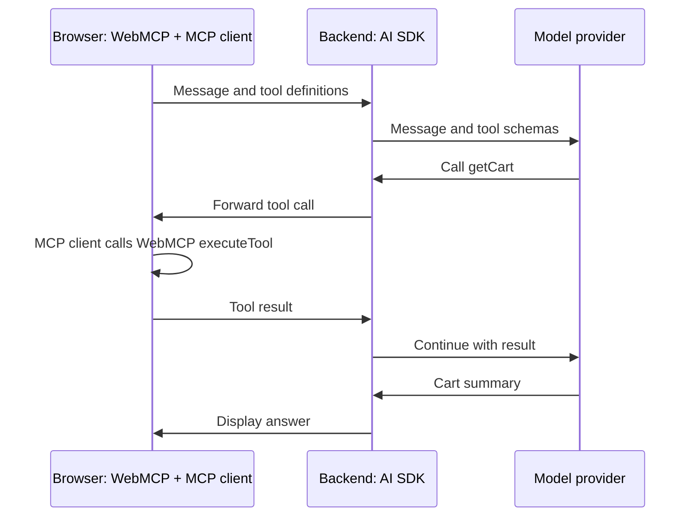

# WebMCP shopping cart assistant

Change the number of T-shirts on the page and ask what is in your cart. The model
calls `getCart`, which reads the current quantity from the open page. Ask again
after changing the quantity to see that the tool reads live browser state.

Open Chrome DevTools Console and filter for `[WebMCP]` to see registration,
discovered definitions, the stored MCP client, tool calls, and returned results.
Expand the client logged after discovery to inspect its transport's tool registry.

The transport is imported as `Experimental_WebMCPTransport as WebMCPTransport`.
The browser API types use the same experimental import alias pattern.

## Run

1. Set `OPENAI_API_KEY` in `examples/ai-e2e-next/.env.local`.
2. From the repository root, build the local packages:
   `pnpm exec turbo build --filter=@ai-sdk/mcp... --filter=@ai-sdk/react... --filter=@ai-sdk/openai... --filter=ai...`.
3. Run `pnpm --filter @example/next-openai dev`.
4. Open `/chat/webmcp` in a browser that supports `document.modelContext.getTools`
   and `executeTool`. For local Chrome development, enable
   `chrome://flags/#enable-webmcp-testing` and restart Chrome.

## Where the code runs

- `page.tsx` registers the browser tool, creates the MCP client with
  `WebMCPTransport`, and executes tool calls in `useChat.onToolCall`.
- `app/api/chat/webmcp/route.ts` uses `createMCPTools(definitions)` to validate
  the forwarded definitions and create the model's tools. They have no
  server-side `execute` function. Passing `{ tools }` to `convertToModelMessages`
  converts returned MCP results to model content. The provider key stays here.
- `addToolOutput` and automatic chat submission return browser results to the
  backend. No additional WebSocket service is needed for this example.

The page lists tools before each request, so each model request gets the current
definitions. The transport itself does not subscribe to `toolchange` events.

Only use this demonstration endpoint in a local development environment. A
deployed application should authenticate access and apply its own policies to
browser-provided tool definitions and results.
