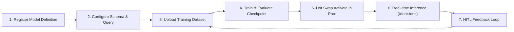

# AI SDK - Zirnay Provider

The **[Zirnay provider](https://ai-sdk.dev/providers/ai-sdk-providers/zirnay)** for the [AI SDK](https://ai-sdk.dev/docs) evaluates decisions using Zirnay Decision-as-a-Service (DaaS) System 1 models with calibrated arbitration, confidence constraints, audit reasoning, and continuous HITL learning.

## Setup

```bash
npm i ai @ai-sdk/zirnay
```

Set your Zirnay credentials:

```bash
export ZIRNAY_API_KEY=your_token_or_key_here
# Optional:
export ZIRNAY_BASE_URL=https://api.zirnay.com/v1
export ZIRNAY_ACCOUNT_ID=your_account_id
```

---

## Complete Zirnay Lifecycle Flow

Zirnay models operate across a continuous lifecycle:



---

### Step 1: Register a Model Definition

Register a tenant model definition:

```ts
import { zirnay } from '@ai-sdk/zirnay';

await zirnay.registerModel({
  teamSlug: 'fraud-ops',
  name: 'Cardholder Fraud Reflex Guard',
  slug: 'laya-card-auth',
  engineType: 'laya',
  version: '1.0.0',
  p99LatencyBudgetMs: 2.5,
  storageProvider: 'S3',
  classes: ['APPROVE', 'CHALLENGE', 'DECLINE'],
  description:
    'System 1 transaction risk scoring evaluated within card authorization SLA.',
});
```

_Equivalent cURL:_

```bash
curl -X POST https://api.zirnay.com/v1/teams/fraud-ops/models \
  -H "Authorization: Bearer $ZIRNAY_JWT_TOKEN" \
  -H "Content-Type: application/json" \
  -d '{
    "name": "Cardholder Fraud Reflex Guard",
    "slug": "laya-card-auth",
    "engine_type": "laya",
    "version": "1.0.0",
    "p99_latency_budget_ms": 2.50,
    "storage_provider": "S3",
    "classes": ["APPROVE", "CHALLENGE", "DECLINE"],
    "description": "System 1 transaction risk scoring evaluated within card authorization SLA."
  }'
```

---

### Step 2: Configure Features Schema, Query, & Calibration

Register the model's schema, query defaults, and Platt temperature scaling calibration:

```ts
await zirnay.updateModelConfig({
  teamSlug: 'fraud-ops',
  modelSlug: 'laya-card-auth',
  config: {
    model_slug: 'laya-card-auth',
    engine_type: 'laya',
    version: '1.0.0',
    query: {
      type: 'choice',
      target: 'Real-time card authorization risk evaluation',
      options: ['APPROVE', 'CHALLENGE', 'DECLINE'],
      fallback_option: 'CHALLENGE',
    },
    features_schema: {
      raw_text: { type: 'string', max_tokens: 64, required: true },
      amount_cents: { type: 'integer', min: 0, required: true },
      currency: { type: 'string', default: 'USD' },
      geo_entropy: { type: 'float', min: 0.0, max: 1.0, required: false },
      velocity_1h: { type: 'integer', min: 0, required: false },
    },
    calibration: {
      method: 'platt_temperature_scaling',
      temperature: 1.15,
      target_ece: 0.025,
    },
    sla: {
      p99_latency_budget_ms: 2.5,
      hard_timeout_ms: 15.0,
    },
  },
});
```

---

### Step 3: Ingest Training Dataset & Train the Model

Upload clean training records (NDJSON / JSONL) and initiate asynchronous training:

```ts
// Ingest training dataset
const { datasetId } = await zirnay.uploadDataset({
  teamSlug: 'fraud-ops',
  modelSlug: 'laya-card-auth',
  filename: 'fraud-train-v1.jsonl',
  data: jsonlRowsContent,
  format: {
    dataset_name: 'fraud-train-v1.jsonl',
    target_field: 'is_fraud',
    fields: [
      { name: 'amount_cents', datatype: 'integer', role: 'feature' },
      { name: 'currency', datatype: 'string', role: 'feature' },
      { name: 'geo_entropy', datatype: 'float', role: 'feature' },
      { name: 'velocity_1h', datatype: 'integer', role: 'feature' },
      { name: 'is_fraud', datatype: 'string', role: 'target' },
    ],
  },
});

// Trigger training run
const trainingRun = await zirnay.triggerTraining({
  teamSlug: 'fraud-ops',
  modelSlug: 'laya-card-auth',
  datasetId: datasetId!,
  hyperparameters: {
    epochs: 12,
    learningRate: 0.0005,
    batchSize: 128,
  },
});
```

_Equivalent cURL:_

```bash
curl -X POST https://api.zirnay.com/v1/teams/fraud-ops/models/laya-card-auth/datasets/upload \
  -H "Authorization: Bearer $ZIRNAY_JWT_TOKEN" \
  -F "file=@dataset-train.jsonl" \
  -F "dataset_name=fraud-train-v1.jsonl"
```

---

### Step 4: Direct Warm Checkpoint Testing (`/decide`)

Perform sub-millisecond testing against the in-memory warm checkpoint:

```ts
const decision = await zirnay.directDecide({
  teamSlug: 'fraud-ops',
  modelSlug: 'laya-card-auth',
  rawText:
    'Card swipe at electronics retailer in Lagos, Nigeria. Billing country: US. Amount: $4,200.',
  query: {
    type: 'choice',
    options: ['APPROVE', 'CHALLENGE', 'DECLINE'],
  },
  features: {
    amount_cents: 420000,
    geo_entropy: 0.94,
    velocity_1h: 6,
  },
});

console.log(decision.decision); // e.g. "DECLINE"
console.log(decision.confidence); // e.g. 0.9842
console.log(decision.executionNanos); // e.g. 1842000 (1.84ms)
```

_Equivalent cURL:_

```bash
curl -X POST https://api.zirnay.com/v1/teams/fraud-ops/models/laya-card-auth/decide \
  -H "X-API-Key: zrn_live_98124acme" \
  -H "Content-Type: application/json" \
  -d '{
    "raw_text": "Card swipe at electronics retailer in Lagos, Nigeria. Billing country: US. Amount: $4,200.",
    "query": { "type": "choice", "options": ["APPROVE", "CHALLENGE", "DECLINE"] },
    "features": { "amount_cents": 420000, "geo_entropy": 0.94, "velocity_1h": 6 }
  }'
```

---

### Step 5: Promote to Production (Zero-Downtime Hot Swap)

Promote the verified checkpoint to production:

```ts
await zirnay.activateCheckpoint({
  teamSlug: 'fraud-ops',
  modelSlug: 'laya-card-auth',
  checkpointId: 'chk_89f02c77',
});
```

_Equivalent cURL:_

```bash
curl -X POST https://api.zirnay.com/v1/teams/fraud-ops/models/laya-card-auth/checkpoints/chk_89f02c77/activate \
  -H "Authorization: Bearer $ZIRNAY_JWT_TOKEN"
```

---

### Step 6: Use the Model in the AI SDK (`experimental_decide`)

Use the promoted model with the AI SDK's standard `experimental_decide` function:

```ts
import { zirnay } from '@ai-sdk/zirnay';
import { experimental_decide } from 'ai';

const result = await experimental_decide({
  model: zirnay.decisionModel('fraud-ops/laya-card-auth:v1.0.0'),
  state: {
    amount_cents: 420000,
    currency: 'USD',
    geo_entropy: 0.94,
    velocity_1h: 6,
    raw_text:
      'Card swipe at electronics retailer in Lagos, Nigeria. Billing country: US. Amount: $4,200.',
  },
  questions: {
    authorization: {
      type: 'choice',
      instructions: 'Evaluate transaction risk within card authorization SLA.',
      criteria: {
        APPROVE: 'Approve transaction; low risk',
        CHALLENGE: 'Trigger step-up 2FA challenge',
        DECLINE: 'Decline transaction; high probability fraud',
      },
    },
  },
  providerOptions: {
    zirnay: {
      constraints: {
        maxEceThreshold: 0.025,
        minConfidence: 0.85,
      },
      arbitrationStrategy: 'calibrated_utility',
    },
  },
});

console.log(result.answers.authorization.choice);
console.log(result.answers.authorization.probabilities);
console.log(result.providerMetadata?.zirnay?.auditTrail);
```

---

### Step 7: Submit Human-in-the-Loop (HITL) Feedback

When a human supervisor reviews or corrects a flagged transaction, submit ground-truth feedback:

```ts
const feedback = await zirnay.submitFeedback({
  model: 'fraud-ops/laya-card-auth:v1.0.0',
  requestId: result.response.id!,
  actualOutcome: 'DECLINE',
  feedbackType: 'CORRECTION',
  reviewer: {
    reviewerId: 'usr_fraud_lead_22',
    reviewerRole: 'SUPERVISOR',
    notes: 'Confirmed card stolen via bank portal.',
  },
});

console.log(feedback.cacheCleared); // true (stale cache purged immediately)
console.log(feedback.ingestedToBuffer); // true (queued for continuous retraining)
```
