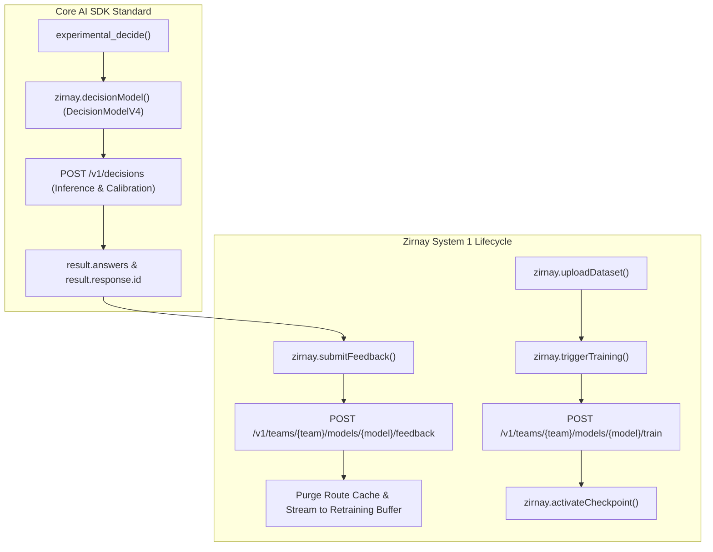

# `@ai-sdk/zirnay` Provider Specification (`SPEC.md`)

## 1. Overview & Goal

`@ai-sdk/zirnay` is a first-party provider package (`packages/zirnay`) for the Vercel AI SDK that exposes **Zirnay Decision-as-a-Service (DaaS)** System 1 decision models (such as `anyjev`, `laya`, and `strands-dc`) through the AI SDK's `Experimental_DecisionModelV4` interface and `experimental_decide()` function.

The goal of this package is to:

1. Provide a direct provider (`@ai-sdk/zirnay`) structured identically to [`@ai-sdk/typesafe-ai`](../typesafe-ai) and [`@ai-sdk/parallel`](../parallel).
2. Register Zirnay model IDs in `@ai-sdk/gateway` (`GatewayDecisionModelId`) and AI SDK documentation so Zirnay is available as a first-class option in upstream `vercel/ai`.
3. Expose Zirnay's calibrated arbitration capabilities (`constraints`, `arbitration_strategy`, `audit_trail`, `candidate_scores`, `telemetry`, and multi-tenant `X-Zirnay-Account-ID` routing) cleanly through `providerOptions.zirnay` and `providerMetadata.zirnay`.

---

## 2. Source of Truth & API Contract Analysis

- **OpenAPI Specification**: `/Users/ram/Documents/workspace/zirnay/backend/src/openapi.yaml` (Version `1.0.0`, _Zirnay Decision-as-a-Service (DaaS) Platform API_)
- **Production Base URL**: `https://api.zirnay.com/v1` (configurable via `baseURL` or `ZIRNAY_BASE_URL`, e.g., `http://localhost:8000/v1`)
- **Authentication**:
  - `Authorization: Bearer <token>` (Bearer JWT / API key — default in AI SDK via `loadApiKey`)
  - `X-API-Key: <key>` (High-performance data-plane API key, e.g., `zrn_live_...`)
  - `X-Zirnay-Account-ID: <account_id>` (Optional multi-tenant header for AI Gateways and aggregators such as Vercel AI Gateway)

### 2.1 Current Zirnay `POST /v1/decisions` Contract

Per `openapi.yaml` (`OpenAIDecisionRequest` / `OpenAIDecisionResponse`), `POST /v1/decisions` (also mounted at `/v1/systemone` and `/inference/v1/systemone`) accepts:

#### Request (`OpenAIDecisionRequest`)

```json
{
  "model": "acme-corp/secops/anyjev-fast-router:v2-strict",
  "input": {
    "deal_id": "356401732297",
    "customer": "Stripe",
    "stage": "Appointment Scheduled",
    "target_close_days": 65,
    "crm_assertions": {
      "metrics": "GREEN",
      "economic_buyer": "YELLOW",
      "paper_process": "YELLOW"
    },
    "evidence_sources": [
      {
        "source": "gong",
        "id": "call_14",
        "snippet": "VP Infra engaged; legal review queued."
      }
    ]
  },
  "decision_type": "categorical_choice",
  "candidates": [
    {
      "id": "COMMIT_APPROVED",
      "label": "Commit to Current Quarter Forecast"
    }
  ],
  "constraints": {
    "max_ece_threshold": 0.03,
    "min_confidence": 0.85
  },
  "arbitration_strategy": "calibrated_utility"
}
```

#### Response (`OpenAIDecisionResponse`)

```json
{
  "id": "dec-zirnay-88e2c39a",
  "object": "decision",
  "created": 1729729050,
  "model": "acme-corp/secops/anyjev-fast-router:v2-strict",
  "decision": {
    "selected_candidate_id": "BEST_CASE_GATED",
    "confidence": 0.942,
    "calibrated_probability": 0.938,
    "margin_over_second": 0.881
  },
  "candidate_scores": [
    {
      "candidate_id": "BEST_CASE_GATED",
      "raw_logit": 3.84,
      "calibrated_prob": 0.938,
      "utility_score": 0.912
    },
    {
      "candidate_id": "COMMIT_APPROVED",
      "raw_logit": -1.12,
      "calibrated_prob": 0.062,
      "utility_score": 0.041
    }
  ],
  "audit_trail": {
    "reasoning_code": "VR_GATE_ECONOMIC_BUYER_UNVALIDATED",
    "explanation": "Economic Buyer confirmed uncontacted at C-level; paper process is unstarted with procurement.",
    "citations": [
      {
        "source": "gong",
        "id": "call_14",
        "relevance": 0.96
      }
    ]
  },
  "telemetry": {
    "latency_ms": 17.2,
    "expected_calibration_error": 0.018,
    "permutation_rounds": 4,
    "data_retention": "DISABLED"
  }
}
```

---

## 3. Alignment with Vercel AI SDK `DecisionModelV4`

### 3.1 How `experimental_decide` Works in `vercel/ai`

In the AI SDK (`packages/provider/src/decision-model/v4/` and `packages/ai/src/decide/validate-decision.ts`), `experimental_decide` passes a **map of named questions** (`questions: Record<string, DecisionModelV4Question>`) evaluated against a single shared `state`:

```ts
const result = await experimental_decide({
  model: zirnay.decisionModel('acme-corp/secops/anyjev-fast-router:v2-strict'),
  state: {
    deal_id: '356401732297',
    customer: 'Stripe',
    stage: 'Appointment Scheduled',
    target_close_days: 65,
    crm_assertions: {
      metrics: 'GREEN',
      economic_buyer: 'YELLOW',
      paper_process: 'YELLOW',
    },
    evidence_sources: [
      {
        source: 'gong',
        id: 'call_14',
        snippet: 'VP Infra engaged; legal review queued.',
      },
    ],
  },
  questions: {
    forecastDecision: {
      type: 'choice',
      instructions: 'Select the forecast category for this deal.',
      criteria: {
        COMMIT_APPROVED: 'Commit to Current Quarter Forecast',
        BEST_CASE_GATED: 'Best Case Gated on Economic Buyer & Paper Process',
      },
    },
  },
  providerOptions: {
    zirnay: {
      constraints: {
        maxEceThreshold: 0.03,
        minConfidence: 0.85,
      },
      arbitrationStrategy: 'calibrated_utility',
    },
  },
});
```

### 3.2 Core Validation Invariants (`validate-decision.ts`)

`packages/ai/src/decide/validate-decision.ts` enforces strict invariants on every `DecisionModelV4.doDecide()` response:

1. **Exact Question Keys**: `result.answers` must contain the exact keys of `options.questions` (no missing or extra keys).
2. **Matching Question Type**: Each `result.answers[id].type` must match `options.questions[id].type` (`'choice' | 'score' | 'boolean' | 'box'`), or be `{ type: 'refusal' }`.
3. **Choice Distribution Invariants**:
   - `answer.choice` must be a key of `question.criteria`.
   - When `answer.probabilities` is present, it must contain **every** option key from `question.criteria`, each value must be in `[0, 1]`, the sum must equal `1` within tolerance (`1e-6` + rounding allowance), and `answer.probabilities[answer.choice]` must be maximal across all options.
4. **Score Distribution Invariants**:
   - `answer.score` must be in `[0, question.criteria.length - 1]`.
   - When `answer.probabilities` is present, its keys must be `'0'` through `String(question.criteria.length - 1)`, sum to `1` within tolerance, and `answer.score` must equal the probability-weighted mean $\sum_{i=0}^{k-1} i \cdot P(i)$ within tolerance.
5. **Boolean Invariant**:
   - `answer.probability` must be a finite number in `[0, 1]` representing $P(\text{true})$.

### 3.3 Protocol Mapping: `DecisionModelV4` $\leftrightarrow$ Zirnay `POST /v1/decisions`

Notice the difference between what `@ai-sdk/openai` sends to `/v1/decisions` vs. Zirnay's current `OpenAIDecisionRequest`:

| Aspect | Zirnay `POST /v1/decisions` (`openapi.yaml`) | `@ai-sdk/openai` `POST /v1/decisions` | `@ai-sdk/typesafe-ai` `POST /v1/systemone` |
| --- | --- | --- | --- |
| **State field** | `input: object` | `input: [{ role: 'user', content: [...] }]` | `state: string \| object` |
| **Questions per request** | Single decision (`decision_type`, `candidates`) | Array (`questions: [{ name, type, ... }]`) | Map (`questions: { [id]: { type, ... } }`) |
| **Choice representation** | `decision_type: "categorical_choice"`, `candidates: [{ id, label }]` | `type: "choice"`, `choices: [{ value, description }]` | `type: "choice"`, `criteria: { [id]: description }` |
| **Boolean representation** | 2 candidates (`true` / `false`) or `binary_classification` | `type: "predicate"` | `type: "noul"` |
| **Score representation** | Ordered candidates `0..N-1` (`ordinal_score`) | `type: "score"`, `levels: [{ label, description }]` | `type: "score"`, `criteria: [...]` |
| **Response probabilities** | `candidate_scores: [{ candidate_id, calibrated_prob, raw_logit, utility_score }]` | `answers: [{ name, type, probabilities: [{ value, probability }] }]` | `answers: { [id]: { type, probabilities: { [k]: p } } }` |

#### Mapping Strategy in `@ai-sdk/zirnay`

`@ai-sdk/zirnay` maps `DecisionModelV4.doDecide()` directly onto Zirnay's `POST /v1/decisions` endpoint:

1. **State Mapping (`state` $\rightarrow$ `input`)**:
   - Single JSON object part (`[{ type: 'json', value: { ... } }]`): sent directly as `input: part.value`.
   - Single text part (`[{ type: 'text', text: '...' }]`): sent as `input: { text: part.text }` (or merged with `instructions` if present).
   - Multiple text/JSON parts: combined into `input: { parts: [...] }` (or if a single JSON object plus question `instructions` is present, `instructions` is attached as question context while preserving the user's `input` object fields).
   - File parts: throw `UnsupportedFunctionalityError` (`Zirnay Decisions file input`), matching `packages/parallel`.

2. **Question Mapping (`questions[id]` $\rightarrow$ `POST /v1/decisions` body)**:
   - **`choice` question**:
     - `decision_type`: `'categorical_choice'` (or overridden via `providerOptions.zirnay.decisionType`)
     - `candidates`: `Object.entries(question.criteria).map(([id, description]) => ({ id, ...(description != null ? { label: toText(description) } : {}) }))`
     - Response mapping:
       - `choice`: `response.decision.selected_candidate_id`
       - `probabilities`: built from `response.candidate_scores` (`{ [score.candidate_id]: score.calibrated_prob }`) when complete for all candidates; omitted if `candidate_scores` is absent.
   - **`boolean` question**:
     - `decision_type`: `'boolean'` (or `'categorical_choice'` with candidates `[{ id: 'true', label: ... }, { id: 'false', label: ... }]`)
     - `candidates`:
       - `{ id: 'true', label: toText(question.criteria?.true ?? question.instructions ?? 'True') }`
       - `{ id: 'false', label: toText(question.criteria?.false ?? 'False') }`
     - Response mapping:
       - `probability`: `calibrated_prob` of candidate `'true'` from `candidate_scores`, or if only `decision` is present: `selected_candidate_id === 'true' ? decision.calibrated_probability : 1 - decision.calibrated_probability`.
   - **`score` question**:
     - `decision_type`: `'ordinal_score'` (or `'categorical_choice'` with indexed candidates)
     - `candidates`: `question.criteria.map((description, index) => ({ id: String(index), label: toText(description) }))`
     - Response mapping:
       - `probabilities`: `{ [score.candidate_id]: score.calibrated_prob }` for `0..N-1`
       - `score`: probability-weighted mean $\sum_{i=0}^{N-1} i \cdot P(i)$ computed from `probabilities` (or `Number(response.decision.selected_candidate_id)` when `candidate_scores` is omitted).
   - **Multi-question handling**:
     - If `Object.keys(questions).length === 1`, a single `POST /v1/decisions` request is dispatched.
     - If `Object.keys(questions).length > 1`, `DecisionZirnayModel.doDecide` dispatches concurrent `POST /v1/decisions` requests (`Promise.all`) for each `[questionId, question]` against the shared `state` (respecting `abortSignal`) and aggregates the answers, confidence, audit trails, and telemetry keyed by `questionId`.
     - *(Future / Backend Enhancement)*: If Zirnay's `POST /v1/decisions` also accepts a batch `questions` map natively, `doDecide` can send a single HTTP call when supported.

3. **Constraints Refusal Mapping**:
   - If Zirnay's `constraints` (`min_confidence` or `max_ece_threshold`) reject or gate a decision (e.g., `decision.selected_candidate_id === null` or `decision.refused === true`), `@ai-sdk/zirnay` maps that question's answer to `{ type: 'refusal' }`, which Core automatically turns into `Experimental_DecisionRefusalError`.

---

## 4. Package Structure (`packages/zirnay`)

Following `contributing/add-new-provider.md` and `packages/typesafe-ai`:

```text
packages/zirnay/
├── src/
│   ├── __fixtures__/
│   │   ├── decision-request.json
│   │   └── decision-response.json
│   ├── index.ts
│   ├── version.ts
│   ├── zirnay-provider.ts
│   ├── zirnay-provider.test.ts
│   ├── zirnay-decision-api.ts
│   ├── zirnay-decision-model-options.ts
│   ├── zirnay-decision-model.ts
│   ├── zirnay-decision-model.test.ts
│   └── lazy-schemas.test.ts
├── CHANGELOG.md
├── README.md
├── SPEC.md
├── package.json
├── tsconfig.json
├── tsconfig.build.json
├── tsdown.config.ts
├── turbo.json
├── vitest.node.config.js
└── vitest.edge.config.js
```

### 4.1 `package.json` Requirements

- `"name": "@ai-sdk/zirnay"`
- `"version": "2.0.0"` (Must be plain `2.0.0` with **no** `-canary` or `-beta` suffix per `contributing/add-new-provider.md`)
- `"prepack": "mkdir -p docs && cp ../../content/providers/01-ai-sdk-providers/115-zirnay.mdx ./docs/"`
- Workspace dependencies:
  - `"@ai-sdk/provider": "workspace:*"`
  - `"@ai-sdk/provider-utils": "workspace:*"`

---

## 5. Public API Design

### 5.1 Provider Factory (`src/zirnay-provider.ts`)

```ts
import type {
  Experimental_DecisionModelV4 as DecisionModelV4,
  ProviderV4,
} from '@ai-sdk/provider';
import type { FetchFunction, Resolvable } from '@ai-sdk/provider-utils';
import type { ZirnayDecisionModelId } from './zirnay-decision-model-options';

export interface ZirnayProvider extends ProviderV4 {
  decisionModel(modelId: ZirnayDecisionModelId): DecisionModelV4;
  /** @deprecated Use `decisionModel` instead. */
  evaluationModel(modelId: ZirnayDecisionModelId): DecisionModelV4 & {
    doEvaluate: DecisionModelV4['doDecide'];
  };
}

export interface ZirnayProviderSettings {
  /**
   * Zirnay API key or JWT token.
   * Defaults to the `ZIRNAY_API_KEY` environment variable.
   */
  apiKey?: Resolvable<string>;

  /**
   * Authentication header mode:
   * - `'bearer'` (default): sends `Authorization: Bearer <apiKey>`
   * - `'x-api-key'`: sends `X-API-Key: <apiKey>`
   * - `'both'`: sends both headers
   */
  authMode?: 'bearer' | 'x-api-key' | 'both';

  /**
   * Optional multi-tenant account identifier sent as `X-Zirnay-Account-ID`.
   * Defaults to the `ZIRNAY_ACCOUNT_ID` environment variable when set.
   */
  accountId?: string;

  /**
   * API base URL.
   * Defaults to the `ZIRNAY_BASE_URL` environment variable,
   * then `https://api.zirnay.com/v1`.
   */
  baseURL?: string;

  /** Custom headers to include in requests. */
  headers?: Record<string, string>;

  /** Custom fetch implementation. */
  fetch?: FetchFunction;
}

export function createZirnay(options?: ZirnayProviderSettings): ZirnayProvider;
export const zirnay: ZirnayProvider;
```

- Calling `zirnay.languageModel(id)`, `zirnay.embeddingModel(id)`, or `zirnay.imageModel(id)` throws `NoSuchModelError`.
- User-Agent suffix: `ai-sdk-zirnay/${VERSION}`.

### 5.2 Model IDs (`src/zirnay-decision-model-options.ts`)

```ts
export type ZirnayDecisionModelId =
  | 'zirnay/anyjev-fast-router:latest'
  | 'zirnay/anyjev-fast-router:v2-strict'
  | 'zirnay/laya:latest'
  | 'zirnay/strands-dc:latest'
  | (string & {});
```

Supports both public baseline slugs (`zirnay/anyjev-fast-router:latest`) and hierarchical tenant-scoped slugs (`<org>/<team>/<model>:<tag>`, e.g., `acme-corp/secops/anyjev-fast-router:v2-strict`).

### 5.3 Provider Options (`src/zirnay-decision-model-options.ts`)

Following the naming convention `{Provider}{ModelType}Options` (`ZirnayDecisionModelOptions` type exported, `zirnayDecisionModelOptions` schema internal):

```ts
export const zirnayDecisionModelOptions = lazySchema(() =>
  zodSchema(
    z.object({
      /**
       * Calibration and confidence constraints enforced by the Zirnay engine.
       * Maps to `constraints` in `POST /v1/decisions`.
       */
      constraints: z
        .object({
          maxEceThreshold: z.number().min(0).max(1).optional(),
          minConfidence: z.number().min(0).max(1).optional(),
        })
        .optional(),

      /**
       * Candidate arbitration strategy.
       * Maps to `arbitration_strategy` in `POST /v1/decisions` (e.g., `'calibrated_utility'`).
       */
      arbitrationStrategy: z.string().optional(),

      /**
       * Override the `decision_type` sent to `POST /v1/decisions`
       * (defaults to `'categorical_choice'` for choice, `'ordinal_score'` for score, `'boolean'` for boolean).
       */
      decisionType: z.string().optional(),

      /**
       * Per-request multi-tenant account ID (`X-Zirnay-Account-ID` header).
       */
      accountId: z.string().optional(),
    }),
  ),
);

export type ZirnayDecisionModelOptions = InferSchema<
  typeof zirnayDecisionModelOptions
>;
```

- Unknown keys in `providerOptions.zirnay` emit `{ type: 'unsupported', feature: 'providerOptions.zirnay.<key>' }` warnings (never silently ignored).
- `maxOutputTokens` and `reasoning` emit `{ type: 'unsupported', feature: 'maxOutputTokens' | 'reasoning' }` warnings.

### 5.4 Provider Metadata (`result.providerMetadata.zirnay`)

```ts
export type ZirnayDecisionProviderMetadata = {
  /** Per-question raw confidence from `decision.confidence`. */
  confidence: Record<string, number>;
  /** Per-question calibrated probability from `decision.calibrated_probability`. */
  calibratedProbability: Record<string, number>;
  /** Per-question margin over second-best candidate from `decision.margin_over_second`. */
  marginOverSecond: Record<string, number>;
  /** Per-question full candidate score breakdown (`raw_logit`, `calibrated_prob`, `utility_score`). */
  candidateScores: Record<
    string,
    Array<{
      candidateId: string;
      rawLogit?: number | null;
      calibratedProb?: number | null;
      utilityScore?: number | null;
    }>
  >;
  /** Per-question audit trail (`reasoning_code`, `explanation`, `citations`). */
  auditTrail: Record<
    string,
    {
      reasoningCode?: string | null;
      explanation?: string | null;
      citations?: Array<{
        source?: string | null;
        id?: string | null;
        relevance?: number | null;
      }> | null;
    }
  >;
  /** Per-question execution telemetry (`latency_ms`, `expected_calibration_error`, `permutation_rounds`, `data_retention`). */
  telemetry: Record<
    string,
    {
      latencyMs?: number | null;
      expectedCalibrationError?: number | null;
      permutationRounds?: number | null;
      dataRetention?: string | null;
    }
  >;
};
```

### 5.5 Response Schema (`src/zirnay-decision-api.ts`)

Per `contributing/providers.md`, response schemas must be minimal, wrapped in `lazySchema(() => zodSchema(...))`, and use `.nullish()` instead of `.optional()`:

```ts
export const zirnayDecisionResponseSchema = lazySchema(() =>
  zodSchema(
    z.object({
      id: z.string().nullish(),
      object: z.string().nullish(),
      created: z.number().nullish(),
      model: z.string().nullish(),
      decision: z.object({
        selected_candidate_id: z.string().nullish(),
        confidence: z.number().nullish(),
        calibrated_probability: z.number().nullish(),
        margin_over_second: z.number().nullish(),
      }),
      candidate_scores: z
        .array(
          z.object({
            candidate_id: z.string(),
            raw_logit: z.number().nullish(),
            calibrated_prob: z.number().nullish(),
            utility_score: z.number().nullish(),
          }),
        )
        .nullish(),
      audit_trail: z
        .object({
          reasoning_code: z.string().nullish(),
          explanation: z.string().nullish(),
          citations: z
            .array(
              z.object({
                source: z.string().nullish(),
                id: z.string().nullish(),
                relevance: z.number().nullish(),
              }),
            )
            .nullish(),
        })
        .nullish(),
      telemetry: z
        .object({
          latency_ms: z.number().nullish(),
          expected_calibration_error: z.number().nullish(),
          permutation_rounds: z.number().nullish(),
          data_retention: z.string().nullish(),
        })
        .nullish(),
      usage: z
        .object({
          input_tokens: z.number().nullish(),
          output_tokens: z.number().nullish(),
        })
        .nullish(),
    }),
  ),
);
```

### 5.6 Workflow Serialization

`DecisionZirnayModel` must implement static `[WORKFLOW_SERIALIZE]` and `[WORKFLOW_DESERIALIZE]` methods:

- `config.headers` is optional (`headers?: Resolvable<Record<string, string | undefined>>`).
- When deserialized inside a workflow step where `this.config.headers` is `undefined`, `doDecide` reconstructs headers using `loadApiKey({ apiKey: undefined, environmentVariableName: 'ZIRNAY_API_KEY', description: 'Zirnay' })` and `withUserAgentSuffix`.

---



---

## 6. Training & Human-in-the-Loop (HITL) Feedback Integration

While inference strictly adheres to the AI SDK's stateless [`DecisionModelV4`](file:///Users/ram/Documents/workspace/ai/packages/provider/src/decision-model/v4/decision-model-v4.ts) interface via `experimental_decide()`, Zirnay's DaaS platform provides continuous learning loops. `@ai-sdk/zirnay` exposes typed control-plane methods on the provider instance (`zirnay` and `createZirnay(...)`).

### 6.1 Human-in-the-Loop (HITL) Feedback

When a supervisor, reviewer, or downstream workflow validates or corrects a decision, feedback is submitted back to Zirnay:
- **Endpoint**: `POST /v1/teams/{team_slug}/models/{model_slug}/feedback`
- **Effect**: Purges stale predictions from the fast-path route cache and buffers records into continuous retraining datasets.

#### TypeScript Signature & Usage
```ts
import { zirnay } from '@ai-sdk/zirnay';
import { experimental_decide } from 'ai';

// 1. Run inference
const result = await experimental_decide({
  model: zirnay.decisionModel('acme-corp/secops/anyjev-fast-router:v2-strict'),
  state: { deal_id: '356401732297', customer: 'Stripe' },
  questions: {
    forecast: {
      type: 'choice',
      criteria: {
        COMMIT_APPROVED: 'Commit to Current Quarter Forecast',
        BEST_CASE_GATED: 'Best Case Gated',
      },
    },
  },
});

// 2. Submit HITL supervisor feedback using result.response.id
const feedback = await zirnay.submitFeedback({
  model: 'acme-corp/secops/anyjev-fast-router:v2-strict', // Or teamSlug: 'secops', modelSlug: 'anyjev-fast-router'
  requestId: result.response.id!,
  actualOutcome: 'COMMIT_APPROVED',
  feedbackType: 'CORRECTION', // 'CORRECTION' | 'AFFIRMATION' | 'ESCALATION'
  reviewer: {
    reviewerId: 'usr_ops_lead_42',
    reviewerRole: 'SUPERVISOR',
    notes: 'Approved after VP signoff.',
  },
});

console.log(feedback.cacheCleared, feedback.ingestedToBuffer);
```

#### Parsing Slug Hierarchy
`submitFeedback` automatically extracts `teamSlug` and `modelSlug` if a qualified model ID like `acme-corp/secops/anyjev-fast-router:v2-strict` is provided:
- If 3 segments (e.g. `org/team/model:tag`), `teamSlug = segments[1]`, `modelSlug = segments[2].split(':')[0]`.
- Direct properties `teamSlug` and `modelSlug` can also be passed explicitly to override.

---

### 6.2 Training Dataset Ingestion & Model Training

For automated retraining pipelines, `@ai-sdk/zirnay` provides direct methods:

1. **`uploadDataset`**:
   - `POST /v1/teams/{team_slug}/models/{model_slug}/datasets/upload`
   - Accepts clean JSONL or NDJSON data along with `DatasetFormat`.
2. **`triggerTraining`**:
   - `POST /v1/teams/{team_slug}/models/{model_slug}/train`
   - Triggers async training runs with hyperparameters (`epochs`, `learning_rate`, `batch_size`).
3. **`activateCheckpoint`**:
   - `POST /v1/teams/{team_slug}/models/{model_slug}/checkpoints/{checkpoint_id}/activate`
   - Promotes trained model weights into production with zero-downtime hot swapping via POSIX mmap.

#### Example Usage
```ts
// Ingest verified records
const { datasetId } = await zirnay.uploadDataset({
  teamSlug: 'secops',
  modelSlug: 'anyjev-fast-router',
  filename: 'verified-outcomes.jsonl',
  data: jsonlContent,
  format: {
    dataset_name: 'secops_ground_truth',
    target_field: 'forecast_outcome',
    fields: [
      { name: 'deal_id', datatype: 'string', role: 'id' },
      { name: 'customer', datatype: 'string', role: 'feature' },
      { name: 'forecast_outcome', datatype: 'string', role: 'target' },
    ],
  },
});

// Trigger training run
const { status } = await zirnay.triggerTraining({
  teamSlug: 'secops',
  modelSlug: 'anyjev-fast-router',
  datasetId,
  hyperparameters: {
    epochs: 10,
    learningRate: 0.001,
    batchSize: 64,
  },
});
```

---

## 7. Upstream Vercel AI SDK Integration Checklist

To make Zirnay a default option in an upstream PR to `vercel/ai` (following [`contributing/add-new-provider.md`](../../contributing/add-new-provider.md)):

1. **New Provider Package (`packages/zirnay`)**:
   - Version set to `2.0.0` in `packages/zirnay/package.json`.
   - Implements `ProviderV4` + `decisionModel` (`DecisionZirnayModel`) + workflow serialization.
   - Unit tests for Node and Edge runtimes (`zirnay-provider.test.ts`, `zirnay-decision-model.test.ts`, `lazy-schemas.test.ts`).
2. **Gateway Model Catalog (`packages/gateway`)**:
   - Add Zirnay decision model IDs (e.g., `'zirnay/anyjev-fast-router'`, `'zirnay/laya'`, `'zirnay/strands-dc'`) to `GatewayDecisionModelId` in [`packages/gateway/src/gateway-decision-model-settings.ts`](../gateway/src/gateway-decision-model-settings.ts).
3. **Examples (`examples/ai-functions`)**:
   - Add `@ai-sdk/zirnay` to `examples/ai-functions/package.json` and `examples/ai-functions/tsconfig.json`.
   - Add `ZIRNAY_API_KEY` to `examples/ai-functions/.env.example` and root `turbo.json`.
   - Add `examples/ai-functions/src/decide/zirnay/basic.ts` demonstrating `experimental_decide` with Zirnay's CRM deal arbitration payload, `constraints`, and `arbitrationStrategy`.
4. **Documentation (`content/`)**:
   - Add `content/providers/01-ai-sdk-providers/115-zirnay.mdx`.
   - Add Zirnay to the provider table in `content/docs/03-ai-sdk-core/32-decisions.mdx`.
5. **TypeScript References & Changeset**:
   - Run `pnpm update-references` to update root `tsconfig.json` and package references.
   - Create a `major` changeset for `@ai-sdk/zirnay` (and `patch` for `@ai-sdk/gateway` if modified).
   - Verify with `pnpm --filter @ai-sdk/zirnay build`, `pnpm --filter @ai-sdk/zirnay test`, `pnpm type-check:full`, and `pnpm check`.

